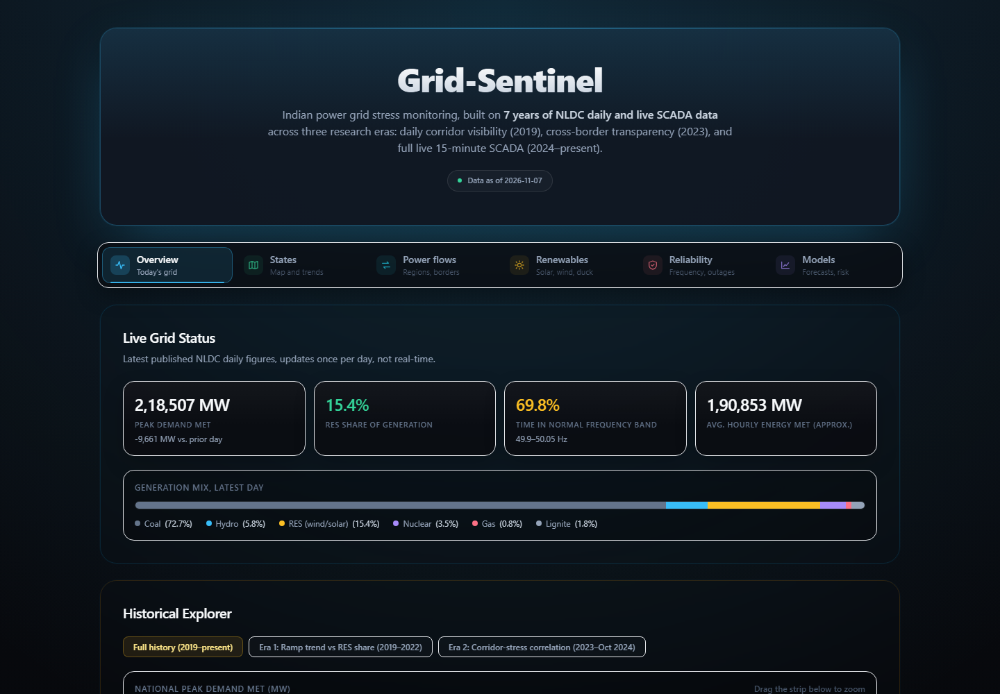
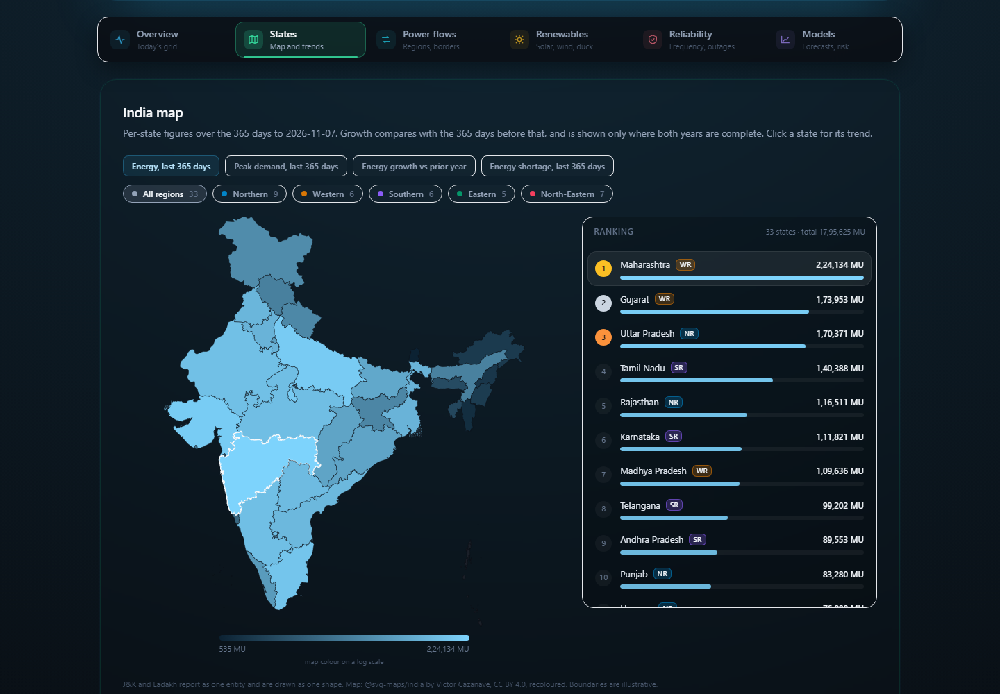

# Grid-Sentinel: Stress Monitoring for India's Power Grid

A live monitor and research project for the Indian national grid, built on seven years of the National Load Despatch Centre's (NLDC) daily Power System Position reports. Every day's report is downloaded, parsed and validated into four public datasets (daily, hourly, 15-minute SCADA and state level). Two LightGBM models retrain on that data every run: a demand forecast, and a 15-minute risk score for frequency violations and sudden ramps. A six-tab dashboard shows the latest grid state, a state map, inter-regional and cross-border power flows, renewables, reliability, and how well the models have actually done.

Built with Python, LightGBM, React and Recharts on public NLDC data, with GitHub Actions running the daily pipeline, Vercel hosting the dashboard and Kaggle publishing the datasets.

> **What it's for:** see how India's grid behaved yesterday and over the last seven years in one place, and test one research question with real data: as monitoring got finer and renewables grew, did grid stress become easier or harder to predict?

**Live dashboard:** [grid-sentinel-vm.vercel.app](https://grid-sentinel-vm.vercel.app/)
**Dataset on Kaggle:** [halcyonvector/india-power-grid-nldc-daily-psp-reports](https://www.kaggle.com/datasets/halcyonvector/india-power-grid-nldc-daily-psp-reports)





<sub>Screenshots taken from the live dashboard on 9 November 2026, with data through 7 November 2026.</sub>

---

## Disclaimer

Grid-Sentinel is an independent student project. It is **not affiliated with NLDC or Grid-India, not an operational tool and not a source of truth for the state of the grid.** Figures are parsed from NLDC's published reports, which arrive the afternoon after the day they describe, so nothing here is real time. The forecasts and risk scores are research baselines; see Honest Limitations.

---

## Findings

- **Rising renewable share goes with more grid stress at 15-minute resolution**, after controlling for season, once SCADA-level data exists (Nov 2024 on). This is a granular result for the Indian grid that complements, rather than restates, macro-level policy findings.
- **Inter-regional corridor flow acts as stress relief, not a stress cause**: a moderate negative correlation with next-day frequency instability.
- **Stress has a day-of-week split**: Sunday has the week's highest frequency-violation rate but its lowest ramp-shock rate, consistent with thinner online reserves on a low-demand day.
- **The ramp-shock classifier is strong** (PR-AUC 0.746 against a 0.177 base rate, about 4.2x lift); **the frequency-violation classifier is real but modest** (PR-AUC 0.154 against 0.031, about 5.0x lift). That gap suggests the two are different phenomena, not two views of one.
- **A tested and falsified hypothesis**: ramp shocks do not precede frequency violations more often than chance. Reported as a dead end rather than left out.
- **A methodology bug was found and fixed**: operating thresholds had been chosen on the test set, which inflated several operating-point metrics. They are now chosen on the validation set and the figures above are the corrected ones.
- **The live demand forecast averages about 2.9% error** over 121 logged forecasts (July to November 2026), scored daily against what actually happened.

---

## Features

### Overview
- Latest published peak demand, renewable share, time in the normal frequency band and generation mix
- Historical explorer from 2019 on, with the three research eras: ramp trend against renewable share (2019 to 2022) and corridor stress correlation (2023 to Oct 2024)

### States
- India map coloured by energy, peak demand, growth against the prior year or shortage, with a ranking by region
- Monthly trend for any state, UT or grid entity since 2019, plus entities that have no map shape (DVC, Railways, bulk consumers)

### Power flows
- Daily net energy over each inter-regional corridor since 2023, and the latest day's flows
- Cross-border exchange with Bhutan, Nepal, Bangladesh and Myanmar by month

### Renewables
- The duck curve from live SCADA: average 15-minute net demand for any month
- Solar, wind and hydro generation and share since 2019

### Reliability
- Time in each frequency band, frequency variation index, forced outages and energy not served, by region and by year

### Models
- Next-day demand forecast against actuals, daily error and a trailing 7-day MAPE
- Holiday correction for the forecast: scales it by the dip the same holiday showed in past years, which cut festival-day error from 12.2% to 2.9% in a 2022 to 2026 backtest
- 96-slot risk timelines for frequency violations and ramp shocks, with a calibration check that shows whether the stated risk is honest

### Pipeline
- Four datasets updated daily, validated on every append and published to Kaggle with per-column descriptions
- Self-healing: a 90-day scan fills any missed days once a fault is fixed, and a daily watchdog run fails loudly on bad data or a stall of more than 5 days

### Dashboard UX
- Each tab is its own code chunk and data file; the first tab loads alone and the others prefetch while the browser is idle
- The current tab stays on screen while the next one loads, with a sliding tab highlight and staggered card entrance, and motion respects reduced-motion settings

---

## Data Source

All data comes from NLDC / Grid-India's [daily PSP reports](https://grid-india.in/en/reports/daily-psp-report), published as PDFs until about 2023 and as XLS files since. Each report covers the previous calendar day. The source is published under India's National Data Sharing and Accessibility Policy (NDSAP).

| File | Rows | Cols | Period | Granularity |
|------|------|------|--------|-------------|
| `study1_daily.csv` | 2,800 | 144 | Dec 2018 to present | 1 row per day |
| `study1_hourly.csv` | 46,728 | 151 | Jan 2019 to Apr 2024 | 1 row per hour |
| `study2_scada.csv` | 68,604 | 164 | Nov 2024 to present | 1 row per 15-min block |
| `study3_states.csv` | 103,985 | 10 | Dec 2018 to present | 1 row per state/UT/entity per day |

Counts as of 9 November 2026; they grow daily. Column-level documentation, known gaps and the dataset license are in [Dataset/README.md](Dataset/README.md) and `Dataset/data_dictionary.xlsx`.

---

## Tech Stack

| Layer | Technology |
|-------|-----------|
| Download | Python, `requests`, Playwright fallback, run daily by Windows Task Scheduler |
| Parsing and validation | Python, `pandas`, `pdfplumber`, `openpyxl`, `xlrd` |
| Models | LightGBM, scikit-learn; notebooks developed on Google Colab |
| Pipeline | GitHub Actions (parse, validate, predict, commit, publish) |
| Dashboard | React 19, Vite, Tailwind CSS, Recharts, deployed on Vercel |
| Distribution | Kaggle, pushed by the workflow with the Kaggle CLI |

---

## Prerequisites

- Python 3.11 or later
- Node.js 20 or later (for the dashboard)
- For the daily download only: Playwright with Chromium (`pip install playwright` then `playwright install chromium`)

---

## Quick Start

```bash
pip install pandas openpyxl pdfplumber requests urllib3 xlrd numpy scikit-learn lightgbm
```

Run the dashboard locally against the committed data:

```bash
cd dashboard
npm install
npm run dev
```

### Rebuilding the data

```bash
python Pipeline/build_all.py              # full rebuild of all four datasets from Dataset/Raw
python Pipeline/validate.py               # checks to run after any rebuild
python Pipeline/build_dashboard_data.py   # regenerate dashboard/public/data/*.json
```

### Daily update

```bash
python Scrapings/update_live.py --scan    # parse any raw files not yet in the CSVs (last 90 days)
python ML/Study1/predict.py               # demand forecast
python ML/Study2/predict.py               # 15-minute risk timeline
```

Both predict scripts accept `--date`, or `--from` and `--to`, to backfill past days.

---

## Project Structure

```
Grid-Sentinel/
├── Dataset/              Published CSVs, data dictionary, Kaggle metadata, prediction logs
│   └── Raw/              Raw NLDC reports, pushed daily by the local scheduler
├── Scrapings/            Download scripts and the per-dataset parsers
├── Pipeline/             Full rebuild, validation, data dictionary, dashboard data, Kaggle metadata
│   └── docs/             One notes file per script: what it does, why, and its history
├── ML/
│   ├── Study1/           Demand forecast: features, daily predict script, notebooks
│   └── Study2/           Violation and ramp-shock classifiers: features, predict script, notebooks
├── dashboard/            React dashboard (one component per tab), deployed on Vercel
├── Reference/            External hourly load data used for study1_hourly
├── docs/screenshots/     Images used in this README
├── run_download.bat      Entry point for the Windows Task Scheduler job
└── .github/workflows/    daily_scrape.yml
```

---

## Architecture

```
Windows Task Scheduler (local PC, daily)
  └─ Scrapings/local_download.py
       downloads any missing reports from the last 7 days, pushes them to Dataset/Raw/
            │
            ▼
GitHub Actions: daily_scrape.yml (runs on that push)
  ├─ update_live.py --scan      parse, append, validate (exit 2 stops the commit)
  ├─ Study 1 and Study 2 predict, logs to Dataset/predictions/
  ├─ build_dashboard_data.py    per-tab JSON for the dashboard
  ├─ commit to main  ──────────►  Vercel deploy hook  ──►  dashboard
  ├─ kaggle_metadata.py + kaggle datasets version  ──►  Kaggle
  └─ alarms: fail the run on a validation error, a crash, or data older than 5 days
```

The download runs on a local PC because GitHub's runners cannot fetch NLDC's files. A scheduled run of the same workflow at 10:30 UTC acts as a watchdog: it reaches the stale-data check, so a stopped scheduler turns the run red within about 5 days.

### Configuration

The workflow needs three repository secrets: `KAGGLE_USERNAME`, `KAGGLE_KEY` and `VERCEL_DEPLOY_HOOK`. A manual run (`workflow_dispatch`) accepts `date`, `scan`, `lookback_days`, `backfill_from` and `publish_kaggle` (`yes`, `no` or `check`).

---

## Validation

There is no unit-test suite. Correctness is checked on the data itself:

- `update_live.py` validates each append (duplicate dates and keys, null-rate jumps) and refuses to commit on failure
- `Pipeline/validate.py` runs the full checks after a rebuild, against the known-gap list in `Pipeline/known_gaps.json`
- The incremental append path was verified byte-identical to a full rebuild for all three daily datasets
- The forecast and risk logs score every prediction against the actual outcome, and the Models tab shows the result

---

## Honest Limitations

- **New data depends on one PC being on.** The scheduler catches up the last 7 days when it next runs, but a longer outage needs a manual run.
- **Not real time.** NLDC publishes each day's report the following afternoon, so the dashboard is at least a day behind.
- **The frequency-violation classifier is modest** (PR-AUC 0.154) and under-predicts: in Sep and Oct 2026, violations occurred in about 9% of slots against an average predicted risk of about 4%.
- **Holidays come from the central gazetted list.** Regional festivals such as Ganesh Chaturthi, Pongal or Onam get no forecast correction, and the day after a holiday is still the hardest to forecast.
- **Source gaps.** `study1_daily` and `study1_hourly` have 69 root-caused missing dates (mostly duplicate NLDC republishes in 2020, plus a few archive gaps). `study2_scada` has 17 dates with no rows (PDF-only days) and 3 corrupted days dropped before training.
- **Coverage varies by era.** Inter-regional line and cross-border columns exist only from about 2023, and the hourly load source ends in April 2024.
- **Format changes break parsing until mapped.** When NLDC added new entities on 30 Sep 2026, validation stopped the pipeline until they were mapped. The workflow now turns red when that happens instead of staying green.

---

## Suggested Future Features

- [ ] Recalibrate the frequency-violation risk score so its stated probability matches observed rates
- [ ] State-level demand forecasts from `study3_states`
- [ ] A small unit-test suite for the parsers, with one fixture report per format era

---

## Author

**Sagnik**

GitHub: [@HalcyonVector](https://github.com/HalcyonVector)

**Abhirami**

GitHub: [@menaegerie](https://github.com/menaegerie)

---

## License

Code is MIT licensed. See [LICENSE](./LICENSE). The published dataset has its own terms; see [Dataset/README.md](Dataset/README.md#license).
